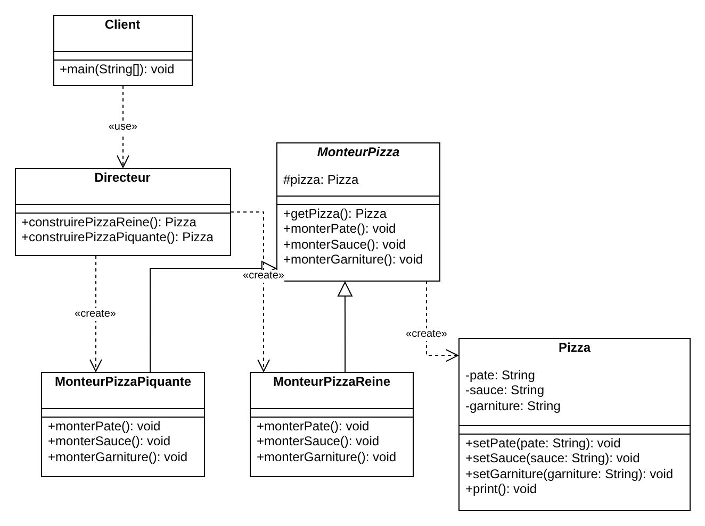
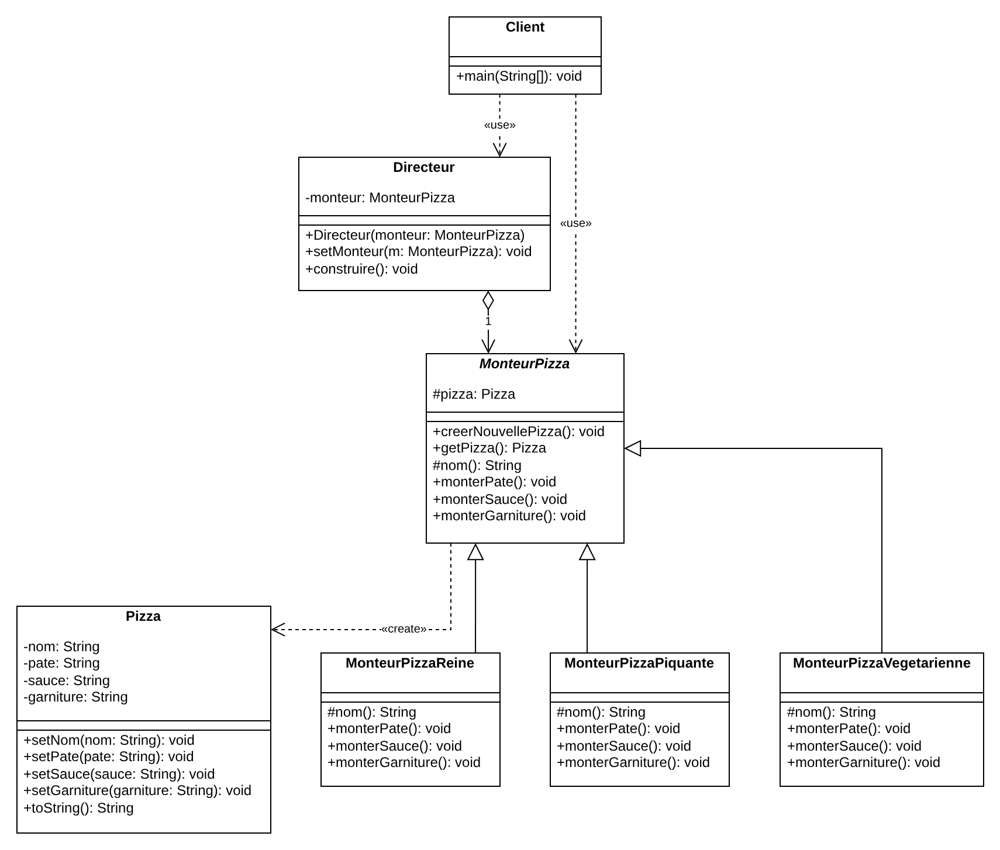

# Patron Builder

Devoir 1 INF4067 - patrons de construction.

- `src/cours` : exemple du cours (pizza reine et pizza piquante)
- `src/modifie` : exemple modifié (le Directeur reçoit le monteur et appelle les étapes, ajout de la pizza végétarienne)

## Lancer

Il faut un JDK 11 ou plus (`java -version` pour vérifier).

Linux / macOS / Git Bash :

```
javac -d out $(find src -name "*.java")
java -cp out cours.builder.Client
java -cp out modifie.builder.Client
```

Windows (PowerShell) :

```
javac -d out (Get-ChildItem -Recurse src -Filter *.java).FullName
java -cp out cours.builder.Client
java -cp out modifie.builder.Client
```

## Diagrammes

Les fichiers `.drawio` sont dans `docs/`.




